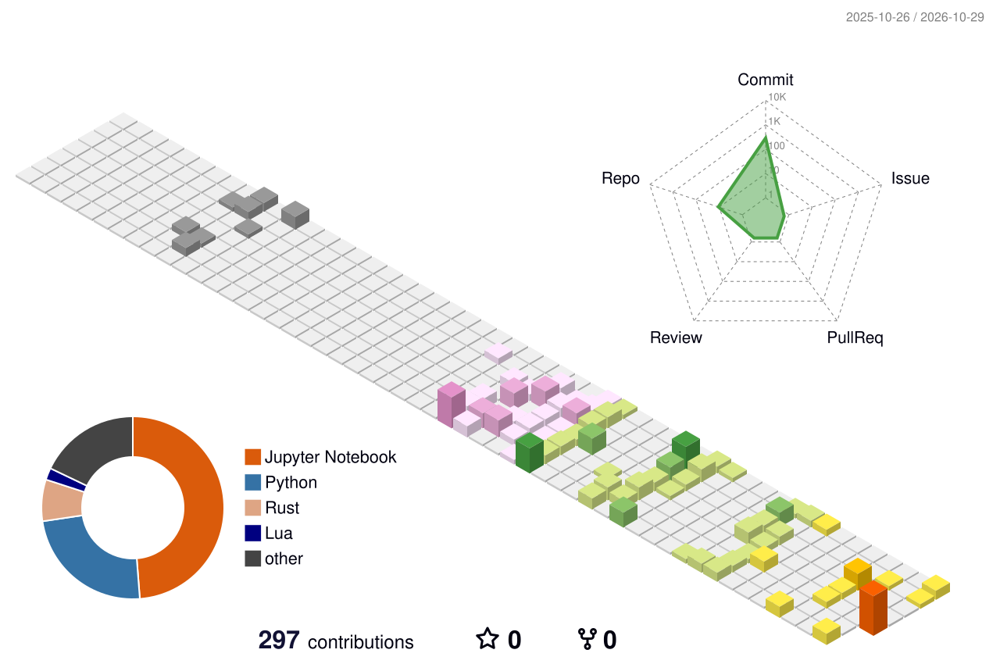

  

---

## Tech Stack & Skills

  

---

## Featured Projects

-  **AI Research** — Research experiments, paper reproduction, and model improvements.
-  **Machine Learning** — ML algorithms, experiments, and evaluation.
-  **Deep Learning** — Neural networks and deep learning applications.
-  **LLMs** — build a LLM model from scratch in rust.

---

## Contribution Calendar

  

---

## Connect With Me

  
  
  
  

  <i>"Understanding the mathematics. Building the models. Exploring the unknown."</i>

